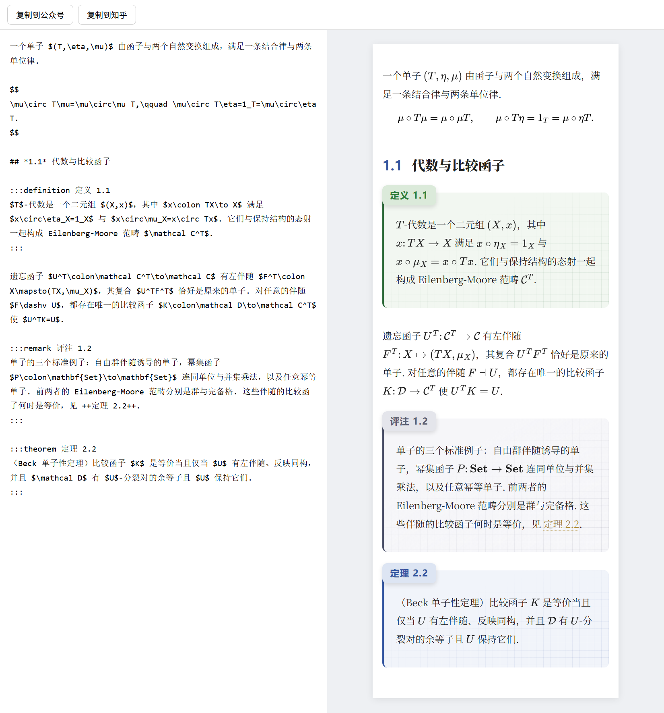

# 数学公众号排版编辑器

用 Markdown + LaTeX 写数学文章，排成「定义 / 定理 / 评注」卡片样式，一键复制到微信公众号或知乎。



## 在线使用

打开 **https://libinyam.github.io/markdown-mods/**

1. 左边写 Markdown，右边是手机宽度的实时预览；
2. 点「复制到公众号」，到公众号后台的正文里粘贴（Ctrl+V）；
3. 发表前用「预览」发到自己手机上看一遍。

草稿会自动保存在当前浏览器里，换浏览器或清除缓存会丢失，重要文章请另存一份 `.md`。

## 本地使用

不需要安装任何东西：

1. 下载 [`index.html`](index.html)（页面右上角 Download raw file），或者 `git clone https://github.com/libinyam/markdown-mods.git`；
2. 双击 `index.html`，用 Chrome / Edge 打开即可。

需要联网，因为公式渲染（MathJax）和 Markdown 解析（marked）都从 jsDelivr CDN 加载。

## 写法

| 写法 | 效果 |
|---|---|
| `$x^2$` | 行内公式 |
| `$$ ... $$`（单独成段） | 行间公式 |
| `## *1.1* 代数与比较函子` | 小节标题，星号包住的编号显示为蓝色 |
| `:::definition 定义 1.1` … `:::` | 绿色卡片（`axiom` 同色） |
| `:::theorem 定理 2.2` … `:::` | 蓝色卡片（`lemma` `corollary` `proposition` 同色） |
| `:::remark 评注 1.2` … `:::` | 灰色卡片（其他类型名都是灰色，如 `proof` `example`） |
| `++定理 2.2++` | 交叉引用（金色虚线） |

卡片的写法是：

```markdown
:::definition 定义 1.1
$T$-代数是一个二元组 $(X,x)$，其中 $x\colon TX\to X$ 满足 $x\circ\eta_X=1_X$.
:::
```

`:::` 后面先写类型（决定颜色），再写标题（显示在标签上）。其他都是标准 Markdown。完整示例见 [`example.md`](example.md)，把它的内容粘贴到编辑器里，就能看到上图的效果。

## 复制到公众号

复制出去的内容和右边预览完全一样，样式已经写进每个元素，公式是 SVG 图形。

- **图片**：直接在公众号后台插入，编辑器不负责上传图片。
- **链接**：公众号正文不允许外部链接，粘贴后会被去掉。
- **字体**：正文使用宋体。iPhone 上显示为宋体，部分安卓手机没有中文衬线字体，会显示为黑体。

## 复制到知乎

知乎会过滤所有自定义样式，所以**卡片、颜色和网格都不会保留**，只保留标题、引用块、加粗和公式。

公式会转换成知乎自带的公式格式（`zhihu.com/equation`），行间公式末尾会自动加 `\\`，让它单独成行。

## 在 md.doocs.org 里使用主题

如果习惯用 [md.doocs.org](https://md.doocs.org)，可以把 [`wechat-math.css`](wechat-math.css) 的内容粘贴到它的「自定义 CSS」里，写法和上表完全相同。

## 修改主题

主题 CSS 有两份，改的时候两处要保持一致：

- `index.html` 里的 `<style id="theme">`，编辑器用；
- `wechat-math.css`，doocs 用。

编辑器复制时，会按 CSS 的书写顺序把规则逐条写进元素的 `style` 属性，后写的覆盖先写的，不看选择器优先级。所以用来覆盖的规则要写在后面。

## 许可

[MIT](LICENSE)
